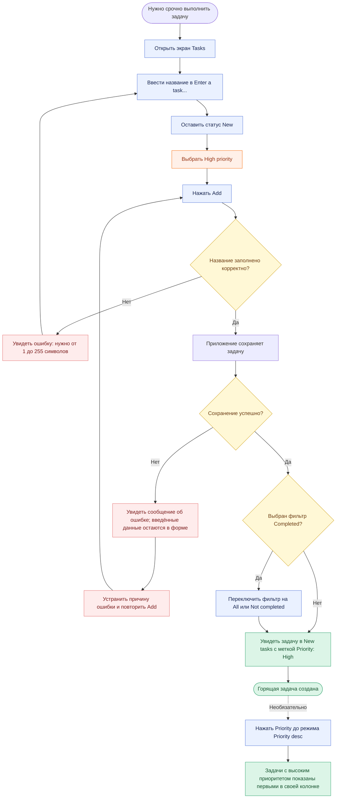

# User flow: создание горящей задачи в ToDo

Основано на текущем приложении. «Горящая» задача означает High priority; отдельного дедлайна или переключателя срочности нет. Подписи элементов сохранены как в интерфейсе. Основной сценарий: пользователь уже вошёл в аккаунт.

Примечания для FigJam:
- Голубые прямоугольники — действия пользователя; оранжевый — выбор высокого приоритета; жёлтые ромбы — условия; красные блоки — ошибки; зелёные — результат.
- Форма создания уже находится на экране Tasks: дополнительной кнопки «Создать задачу» или модального окна нет.
- По умолчанию выбраны New и Medium priority. После успешного сохранения форма очищается и возвращает эти значения.
- При истечении сессии приложение просит обновить страницу; может потребоваться повторный вход и ввод данных.
- Сортировка по приоритету включается отдельно и не запускается автоматически после создания.
